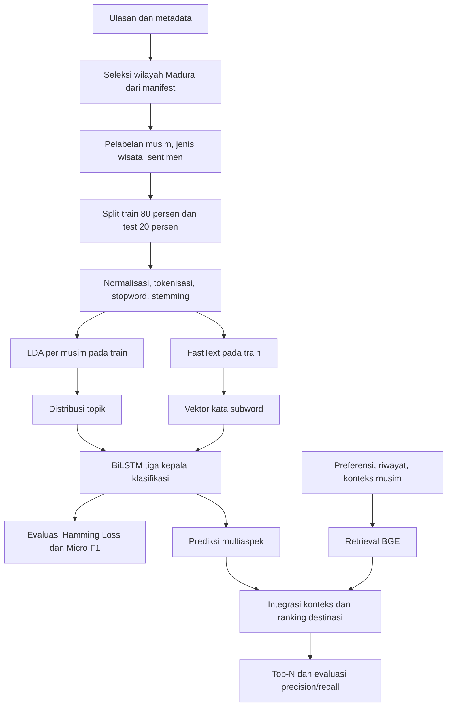

# Metode sesuai proposal asistensi Malik

Acuan utama: **PROPOSAL ASISTENSI PENELITIAN_MALIK HARIYANTO_230441100067.docx.pdf**,
posisi kontribusi halaman cetak 18 dan Bab III §3.3–3.11, halaman cetak 20–22.
PDF TKA yang sempat diberikan tidak digunakan sebagai acuan metode.

## Pembeda penelitian induk

| Komponen | Proposal kolaborasi | Proposal Malik |
| --- | --- | --- |
| Topik | LDA per musim | Tetap LDA |
| Representasi kata | Word2Vec | **FastText, subword karakter n-gram** |
| Klasifikasi | BiLSTM multi-output | Tetap BiLSTM |
| Target | Musim, jenis wisata, sentimen | Tiga aspek yang sama |
| Personalisasi | BGE dan konteks musim | BGE, preferensi/riwayat dan musim |
| Skenario | Word2Vec, LDA, gabungan | FastText, LDA, gabungan |

Notebook BGE-M3/E5/Adaptive Fusion adalah bahan retrieval tambahan.
**Adaptive Fusion bukan pembeda proposal Malik.** Keunggulan FastText pada data
ini belum dibuktikan dan tidak diasumsikan.

## Alur program



## Keputusan implementasi eksplisit

- Jalur audit/retrieval menggunakan teks asli dengan pembersihan ringan. Jalur
  classifier terpisah: lowercase, tokenisasi huruf Unicode, stopword Sastrawi,
  stemming. Negasi tidak/bukan/belum/jangan/kurang dipertahankan untuk sentimen.
- Sesuai keputusan pengguna, target musim memakai kelas asli rekomendasi_cuaca:
  Kemarau dan Kemarau & Penghujan; target sentimen memakai rating 1–2 negatif,
  3 netral, 4–5 positif. Jenis wisata mengikuti kategori asli dataset. Tidak
  membuat label liburan atau mengonversi date menjadi tanggal kunjungan.
- Split 80/20 dikelompokkan menurut teks ternormalisasi agar duplikat identik
  tidak tersebar di train/test. Seed dan review_id split disimpan. Ini belum
  menjamin generalisasi ke destinasi baru atau masa depan.
- Vocabulary, LDA, FastText/Word2Vec hanya fit pada train. Epoch ditetapkan
  sebelum test; tidak ada pemilihan model berdasarkan skor test.
- Bank LDA dilatih terpisah per musim pada train. Saat inferensi **semua bank
  ditransformasi dan dikonkatenasi**, tanpa memilih bank menggunakan label target.
  Memilih bank dari musim jawaban test akan membocorkan target. Proposal belum
  merinci langkah ini; concatenation bank adalah keputusan implementasi.
- FastText saja: urutan vektor kata → BiLSTM. LDA saja: distribusi topik sebagai
  urutan **satu langkah** → BiLSTM. Gabungan: topik dokumen dikonkatenasi ke tiap
  vektor kata → BiLSTM. LDA satu langkah bukan urutan token buatan.
- Tiga kepala categorical softmax; loss adalah jumlah cross-entropy tiga aspek.
  FastText memberi vektor OOV melalui subword; Word2Vec pembanding memakai nol
  untuk OOV dengan seed/dimensi/split yang sama.
- Pada target single-label, Micro F1 per aspek setara accuracy. Hamming Loss
  per aspek adalah proporsi keputusan salah; overall merata-ratakan semua
  keputusan pada tiga aspek. Ini dibedakan dari hamming pada matriks multi-hot.
- Minimal 20 baris berlabel valid pada CLI adalah batas teknis, bukan ukuran sampel
  yang dinyatakan cukup secara ilmiah.

## Eksperimen data nyata

```bash
python -m pip install -r requirements-model.txt
python -m wisata.labeling data/koreksi_dataset.xlsx --output artifacts/madura_labels.csv
python -m wisata.experiments artifacts/madura_labels.csv --output artifacts/experiments-dataset-v1 --epochs 10
```

Manifest cakupan mengikuti empat kabupaten Madura dalam proposal kolaborasi.
5.071 ulasan bersih dari 20 destinasi included; dua kandidat lokasi masih pending.
Workbook sumber tidak diubah dan tidak difilter permanen. Semua label derived
memiliki provenance. Definisi target ini merupakan adaptasi operasional proposal
berdasarkan keputusan pengguna, bukan empat kelas musim/liburan aslinya.

## Retrieval dan integrasi classifier

wisata.retrieval mengimplementasikan BGE-M3 dense beku, embedding L2 dan cosine.
Skor destinasi adalah rata-rata min(5, jumlah kandidat) skor ulasan tertinggi.
Filter musim memakai label metadata dan hanya kandidat valid yang diranking.
Jika artefak classifier disertakan saat membangun indeks, prediksi sentimen
BiLSTM menjadi dasar filter sentimen. Prediksi ketiga aspek disimpan pada indeks;
label musim sumber tetap dipakai untuk menjamin konsistensi filter pengguna.
Tanpa classifier, sumber filter sentimen dinyatakan rating-derived.

Manifest mengikat korpus lengkap, urutan ulasan, model/revisi, panjang token,
checksum embedding dan metadata. Query menggunakan encoder yang sama.
Ulasan bukti dipilih dari ulasan kandidat dengan cosine tertinggi; skor bukan
probabilitas. Rating hasil adalah rata-rata ulasan kandidat setelah filter.

## Batas interpretasi

Evaluasi classifier mengukur pemulihan label turunan rating/cuaca/kategori,
bukan agreement terhadap sentimen manusia atau musim kunjungan terverifikasi.
Label cuaca dan jenis wisata konstan per destinasi; split ulasan tidak menguji
transfer ke destinasi baru. Sebaran sentimen didominasi positif sehingga Macro F1
serta dukungan setiap kelas perlu dibaca bersama Micro F1. Seed disimpan, tetapi
identitas hasil bitwise lintas platform/Python hash seed tidak dijamin.

Indeks BGE asli telah dibangun dari seluruh cakupan dan diuji melalui query
baru serta filter; BF16 dipakai pada CPU yang mendukung dan presisi dicatat dalam
manifest agar query/index konsisten. Unit test fixture hanya memeriksa mekanika;
evaluasi model asli dipisahkan dalam HASIL_EKSPERIMEN.md. Known-item 20 query
memakai leave-query-out; bukan human qrels. Riwayat pengguna, deployment publik,
dan evaluasi kebutuhan pengguna dengan penilaian manusia belum dilakukan.
